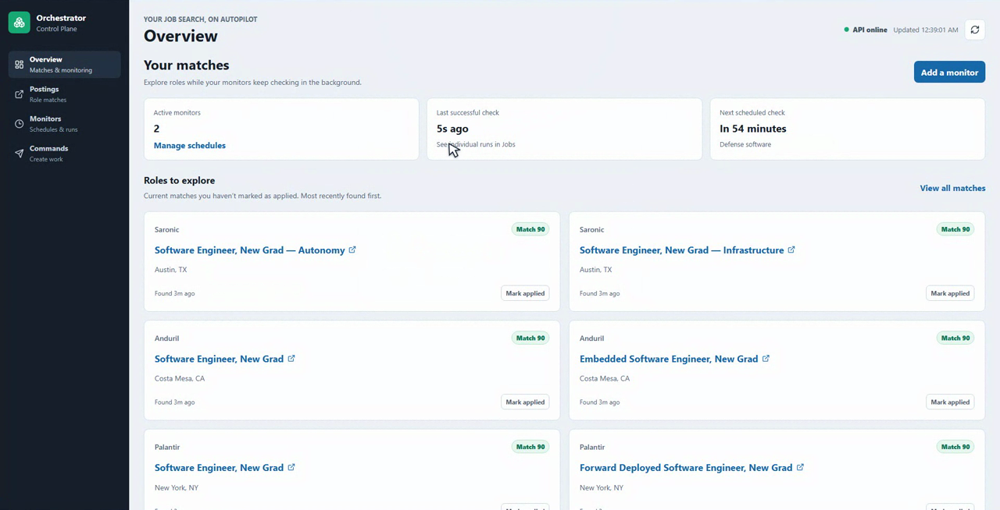
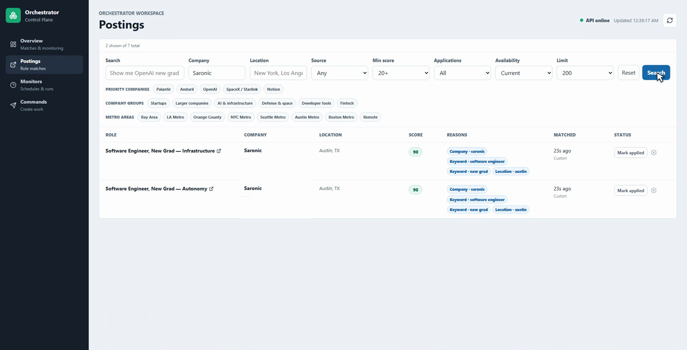
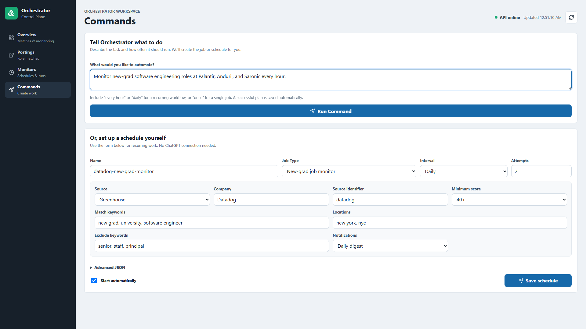
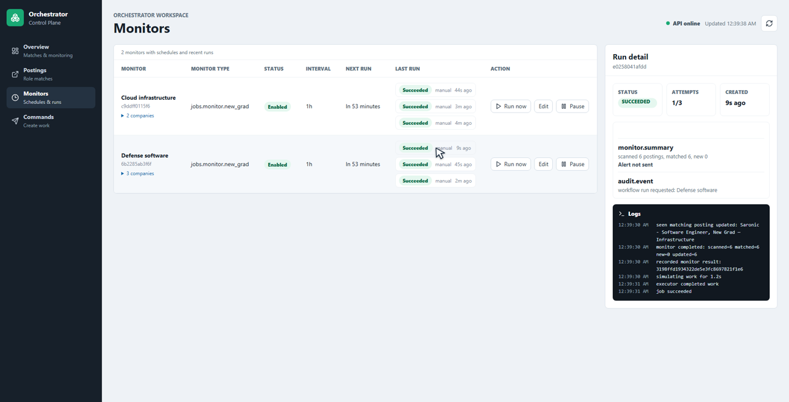
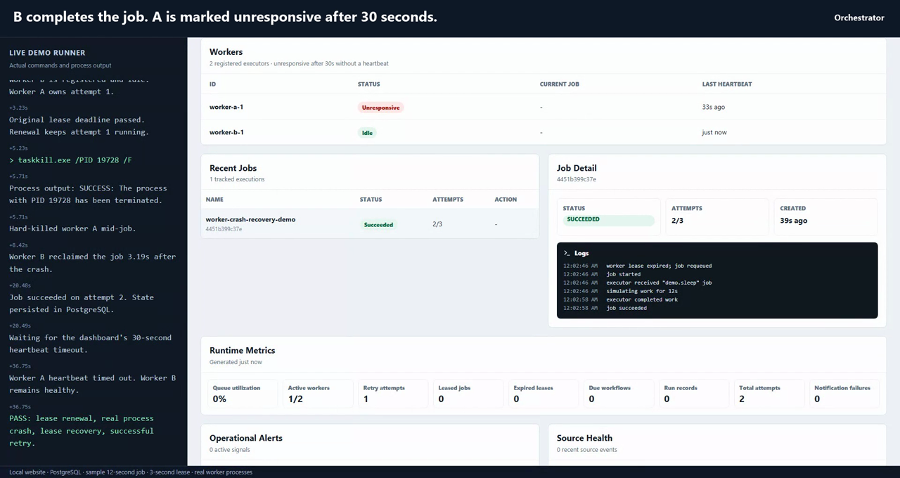

# Distributed Job Orchestrator

A Go-based job orchestration platform with a React operations dashboard, worker execution, retries, durable Postgres state, scheduled workflows, and natural-language job planning. The flagship workflow monitors public job boards for targeted new-grad software engineering roles and sends tracked email alerts when useful matches appear.

This repository runs locally, on your own server, or as the hosted pilot at [job-orchestrator.duckdns.org](https://job-orchestrator.duckdns.org). The hosted site supports Google and email/password accounts with separate saved workspaces. See [public website setup](docs/hosted-website.md) for the account, ChatGPT connection, deployment, and email-delivery details.

## Highlights

- Durable Go control plane with a job state machine, renewable worker leases, rejection of stale worker outcomes, retry/dead-letter behavior, and Postgres-backed queue mode.
- Recurring workflow scheduler with idempotent dispatch records and manual run support.
- Real product workflow for monitoring Greenhouse, Lever, Ashby, SmartRecruiters, Workday, and custom job feeds.
- Automatic ATS adapter detection from supported careers-board URLs, alongside explicit source configuration.
- Per-source monitor health: failed sources are reported as warnings when other sources return successfully, and transient failures can retry the job.
- Seed scripts for recurring monitors at OpenAI, Palantir, Anduril, SpaceX/Starlink, Notion, and other engineering-focused companies.
- React operations dashboard for queue health, jobs, workflow runs, workers, postings, application tracking, results, logs, metrics, and alerts.
- Monitor views show configured companies, schedules, recent runs, source warnings, and recovery state; matched postings can be tracked as applied.
- Natural-language job/workflow planning through a local `OPENAI_API_KEY` or each hosted user's connected ChatGPT/Codex account.
- Idempotent natural-language scheduling that reuses an equivalent workflow instead of creating duplicates.
- Tracked SMTP delivery with configurable recipients and persisted success/failure state; hosted alerts and digests are delivered to each account's verified email address.
- Automated backend tests, Postgres integration coverage, frontend type-checking, production builds, and a hosted-dashboard browser regression check.

## Product Tour

[Download the 83-second product overview (MP4)](https://raw.githubusercontent.com/mdavidrobertsonjr/orchestrator/main/docs/demo/orchestrator-demo.mp4) to see posting filters, application tracking, monitor runs, pause/resume controls, schedule editing, and execution logs. The recording uses sample postings on the current local website, with a visible cursor and click indicators.

Try commands such as `Monitor new-grad software engineering roles at OpenAI, Palantir, Anduril, and SpaceX every hour.` Equivalent requests reuse the existing workflow instead of creating duplicates.

| Matches overview | Matched job postings |
| --- | --- |
|  |  |

| Commands and schedule setup | Monitor runs |
| --- | --- |
|  |  |

The screenshots use local sample postings.

### Worker crash recovery

[Download the 35-second worker crash recovery demo (MP4)](https://raw.githubusercontent.com/mdavidrobertsonjr/orchestrator/main/docs/demo/worker-crash-recovery.mp4).

Worker A runs a sample job while worker B waits idle. A real process-termination command kills A, then B automatically claims attempt 2 after the job lease expires and finishes the job. The dashboard later marks A **Unresponsive** and shows **1 of 2 workers active**.

[](https://raw.githubusercontent.com/mdavidrobertsonjr/orchestrator/main/docs/demo/worker-crash-recovery.mp4)

The recording shows the local website, PostgreSQL, and actual worker processes. It uses a timed sample workload and a shortened 3-second job lease. Part of the wait for the 30-second heartbeat timeout is labeled **4× speed**.

To reproduce the recovery check, install Go and Docker, then run:

```bash
make demo-recovery
```

This starts a disposable PostgreSQL container, runs both workers, terminates A, verifies B completes attempt 2, and removes the container afterward. The command prints execution events as JSON.

## What It Does

- Accepts immediate jobs and recurring workflow definitions.
- Converts English requests into structured jobs or workflows when a local `OPENAI_API_KEY` or hosted ChatGPT/Codex connection is configured.
- Runs work through embedded or standalone workers with retries, leases, and dead-letter handling.
- Persists jobs, logs, workflows, runs, postings, results, notifications, and audit events in Postgres.
- Shows queue health, workers, logs, workflow runs, postings, results, metrics, and operational alerts in the dashboard.
- Supports deployment as a single server or as separate API, worker, and Postgres processes.

## Quick Start

Use Go 1.25 or newer and Node.js 22.12 or newer with npm. The Makefile and helper scripts use GNU Make and Bash. Docker with the Compose plugin is required for the containerized stack and Postgres helper commands.

Clone the repository and install the locked frontend dependencies. Use Postgres for durable state across restarts.

Install frontend dependencies once:

```bash
cd frontend
npm ci
cd ..
```

Run the API and dashboard together with in-memory storage:

```bash
make dev
```

Open the dashboard at:

```text
http://localhost:5173
```

Run the production-style single-server website:

```bash
make website
```

Open:

```text
http://localhost:8080
```

For a containerized API, standalone worker, and Postgres stack:

```bash
make compose-app
```

The API serves the built dashboard at `http://localhost:8080`. For frontend development with Vite hot reload, optionally run `make frontend` in a second terminal and open `http://localhost:5173`.

## Common Commands

```bash
make test                 # Backend tests and frontend build
make demo                 # Seed and run a deterministic fake job monitor
make demo-recovery        # Verify recovery after terminating a worker
make dev-postgres         # API and dashboard with local Postgres
make website-postgres     # Built dashboard served by API with Postgres
make dev-distributed      # API, dashboard, Postgres, and standalone worker
make smoke-postgres       # Postgres integration checks
make migrate-postgres     # Apply Postgres migrations explicitly
make migration-gate       # Verify startup with automatic migrations disabled
make smoke-distributed    # Distributed API/worker smoke test
make check-deploy         # Validate deployment environment settings
make compose-app          # Containerized API, worker, and Postgres
make compose-app-stop     # Stop the containerized app stack
make prune-postings       # Dry-run removal of low-signal postings
make postgres-stop        # Stop local Postgres
```

`make test` runs the backend Go tests and frontend production build. The hosted
dashboard browser regression check is separate; after installing dependencies and
building the frontend, run:

```bash
cd frontend
npx playwright install --with-deps chromium
npm run test:hosted
```

For a small VPS or cloud VM deployment, see [Deploy On A Small VPS](docs/deploy-vps.md).

## Configuration

For local development, copy `.env.example` to `.env` and fill in only the values you need. Clear `ORCH_SMTP_HOST` to use simulated email delivery while trying the app locally. `make dev`, `make backend`, and `make website` load `.env` automatically.

Authentication:

```bash
ORCH_AUTH_TOKEN=replace-with-a-long-random-token make website-postgres
```

`ORCH_AUTH_TOKEN` protects dashboard API calls and operational endpoints under `/v1` and `/metrics`. API clients can send either `Authorization: Bearer <token>` or `X-Orchestrator-Token: <token>`. Health and readiness checks remain public for deployment probes.

Scoped API keys are also supported:

```bash
ORCH_API_KEYS='dashboard:long-random-token:read+write+metrics;prometheus:metrics-token:metrics' make website-postgres
```

Supported scopes are `read`, `write`, `metrics`, and `admin`. `ORCH_AUTH_TOKEN` remains supported and is treated as an admin key.

Natural-language commands:

```bash
OPENAI_API_KEY=sk-... make website
```

The backend uses `ORCH_OPENAI_MODEL=gpt-5.4-nano` by default. Without `OPENAI_API_KEY`, structured job and workflow submission still works.

The hosted website does not use a shared site-wide API key for planning. After signing
in, each visitor connects their own ChatGPT/Codex account; that connection plans the
request and its account limits apply. The website's scheduler and workers then run the
resulting job on the hosting server.

Email delivery:

```bash
ORCH_SMTP_HOST=smtp.example.com \
ORCH_SMTP_PORT=587 \
ORCH_SMTP_USERNAME=apikey-or-user \
ORCH_SMTP_PASSWORD=secret \
ORCH_SMTP_FROM=orchestrator@example.com \
ORCH_DEFAULT_RECIPIENTS=you@example.com \
make website
```

If `ORCH_SMTP_HOST` is not set, email delivery is simulated for local development.

Retries reuse the same logical email delivery record and skip recorded successes. A delivery interrupted during sending, or followed by an SMTP error, requires operator review before resending because the provider may already have accepted the message. See [email retry recovery](docs/hosted-website.md#email-retry-recovery) for recovery instructions.

Hosted deployments use `ORCH_AUTH_SMTP_*` for account verification and password
recovery, and the same authenticated sender for monitor alerts and digests. The SMTP
account is the sender identity; hosted notifications are addressed to the signed-in
account's verified email and are restricted to that address.

## Job Monitoring

Run the deterministic demo while the backend is running on `:8080`:

```bash
make demo
```

Seed recurring real-company monitors:

```bash
make seed-job-monitors
```

The seed script creates hourly `jobs.monitor.new_grad` workflows using supported public ATS APIs. Override the target API or schedule interval when needed:

```bash
ORCH_MONITOR_URL=http://localhost:8080 ORCH_MONITOR_INTERVAL_SECONDS=86400 make seed-job-monitors
```

Monitor sources may be configured explicitly by ATS type, or supplied as a supported
careers-board URL for automatic adapter detection. A failed company source does not
discard results from healthy sources: the run records source-level warnings and
continues when at least one source succeeds. Transient failures across all sources
remain retryable. The dashboard shows warnings with run details and clears stale
failure indicators after a successful recovery.

See [Job Types](docs/job-types.md) for supported executors, payload examples, notification settings, and monitor sources.

## Architecture

```text
Dashboard / API clients
        |
        v
Go HTTP control plane
        |
        +--> Jobs store and queue
        +--> Workflow definitions and run history
        +--> Posting/result/notification stores
        +--> Worker registry and metrics
        |
        v
Scheduler creates due jobs
        |
        v
Workers claim jobs with leases
        |
        v
Typed executors store results and send notifications
```

Workers renew their job lease while executing and can update an attempt's outcome only while they still own its live lease. A failed renewal cancels the execution context. The default lease lasts two minutes and expired leases are checked every 15 seconds. The recovery demo shortens those timings for the recording.

Worker heartbeats are separate from job leases. After 30 seconds without a heartbeat, the dashboard marks a worker **Unresponsive**, clears its displayed assignment, and excludes it from active counts. A normal shutdown is displayed as **Stopped**. Job recovery follows the lease deadline and sweep interval.

For deeper architecture notes, see [System Design](docs/system-design.md). For project positioning and future direction, see [Project Framing](docs/project-framing.md).

## API And Dashboard

Representative endpoints:

- `POST /v1/commands/natural`: create or reuse an immediate job or recurring workflow from English.
- `POST /v1/jobs`: submit an immediate job.
- `POST /v1/workflows`: create a recurring workflow.
- `PATCH /v1/workflows/{id}`: edit the schedule, payload, or retry limit, or enable or pause a workflow.
- `DELETE /v1/workflows/{id}`: safely delete a paused workflow.
- `POST /v1/workflows/{id}/run`: manually trigger a workflow.
- `PATCH /v1/postings/{id}`: mark or unmark a posting as applied.
- `GET /v1/jobs`, `GET /v1/workflow-runs`, `GET /v1/postings`, `GET /v1/results`: inspect state.
- `GET /v1/workers`, `GET /v1/metrics`, `GET /metrics`: inspect runtime and Prometheus metrics.
- `GET /healthz`, `GET /readyz`: process and dependency health checks.

Collection endpoints support pagination with `limit` and `offset`, or `page_size` and `page`. Posting filters include application status and freshness; current results hide un-applied postings not seen by a monitor for 48 hours without deleting their history. In Postgres mode, filters and pagination are pushed into SQL for jobs, postings, workflow runs, and results.

Backend-specific API notes are in [backend/README.md](backend/README.md). Frontend-specific notes are in [frontend/README.md](frontend/README.md).

## Public website accounts

The hosted pilot is available at [job-orchestrator.duckdns.org](https://job-orchestrator.duckdns.org).
Visitors only need a browser: sign in with Google or email/password, connect their own
ChatGPT account, and use natural language to create jobs or recurring workflows. Each
account gets an isolated workspace; the server's scheduler and workers continue running
when the browser is closed. Job monitor alerts and digests go to that account's verified
email address.

See [the hosted website guide](docs/hosted-website.md) for the complete visitor flow,
SMTP requirements, security boundaries, and self-hosting instructions. The hosted site
uses the separate `compose.hosted.yaml` deployment; the private token-based
API/dashboard commands remain available for local and self-hosted use.
